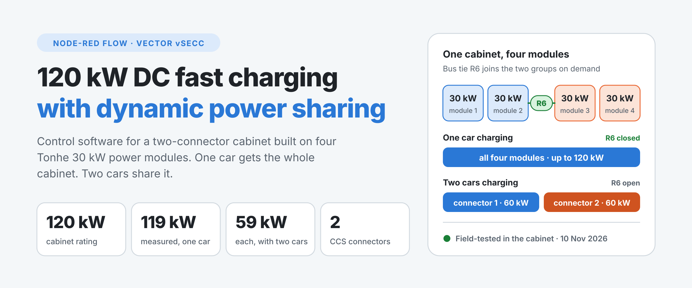
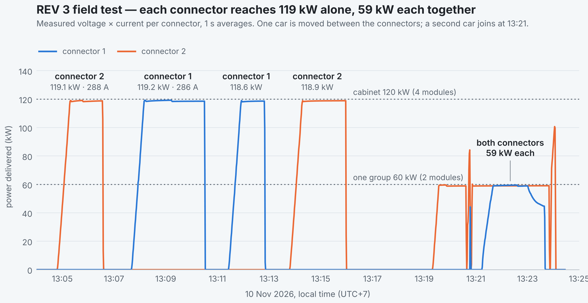
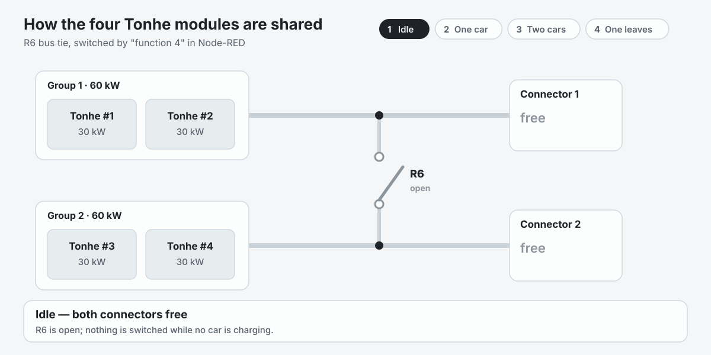
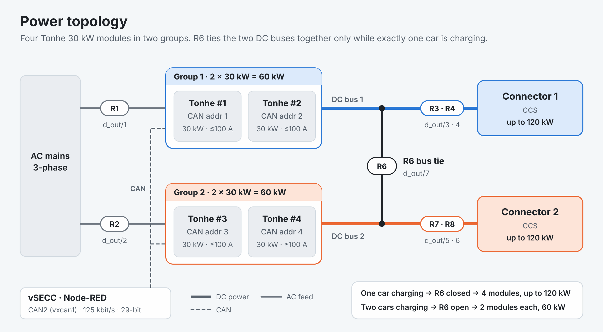
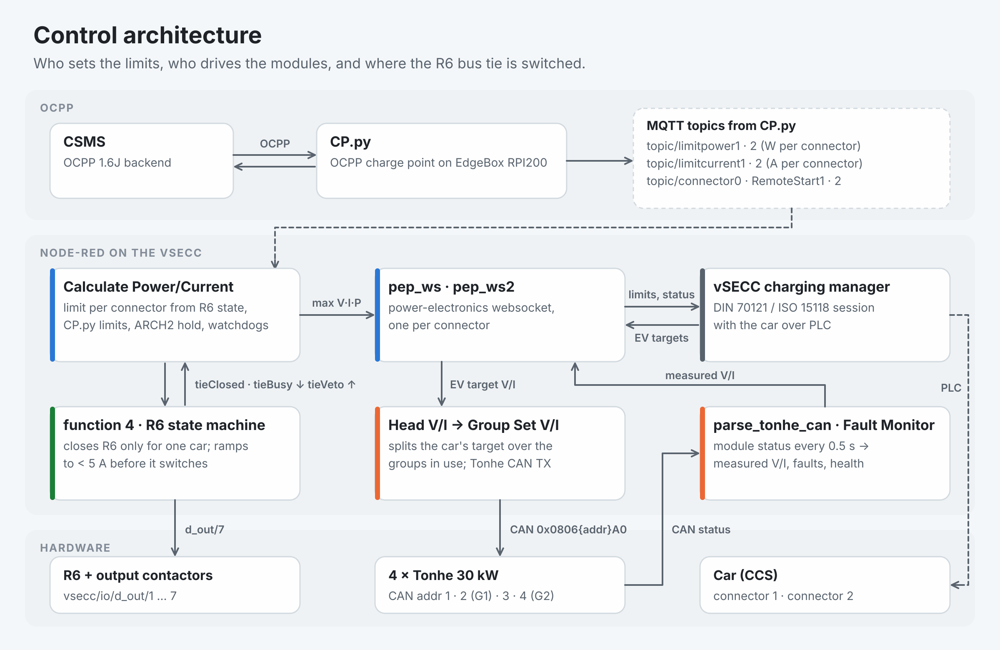

<picture>
  <source media="(prefers-color-scheme: dark)" srcset="docs/images/hero-dark.png">
  
</picture>

# Bhutan 120 kW DC Charger Controller

**Dynamic power-sharing control for a two-connector DC fast charger — a complete Node-RED flow for the Vector vSECC and four Tonhe 30 kW power modules.**

[Why it matters](#why-it-matters) · [Field results](#field-results) · [How it works](#how-it-works) · [Features](#features) · [Specifications](#technical-specifications) · [Get started](#get-started) · [Documentation](#documentation) · [Support](#support-and-customization)

---

A 120 kW cabinet with two connectors usually gives each connector half the power, even when only one car is plugged in.
This controller joins the two module groups through a DC bus tie whenever a single car is charging, so that car gets **all four modules**. When a second car arrives, the tie opens and each car gets its own **60 kW** group.

It runs in a real cabinet in Bhutan. On 10 November 2026 it delivered **119 kW on each connector** with one car and **59 kW on each** with two cars.

## Why it matters

<table>
<tr>
<td width="33%" valign="top">

### Full power for one car

All four modules serve whichever connector is in use. Each connector reached **119 kW** in the field test, about 99 % of the cabinet rating.

</td>
<td width="33%" valign="top">

### A clean split for two

When a second car plugs in, the current is ramped below 5 A before the bus tie opens. Each car then charges on its own two modules, **59 kW each** measured.

</td>
<td width="33%" valign="top">

### Decisions you can audit

Every sharing decision is traced into the vSECC log with its reason. A stopped session or a reduced limit can be traced from the log download.

</td>
</tr>
</table>

## Field results

REV 3 was deployed in the cabinet on 10 November 2026 and tested with two cars the same day.

<picture>
  <source media="(prefers-color-scheme: dark)" srcset="docs/images/field-test-rev3-dark.png">
  
</picture>

| Test | Time (UTC+7) | Connector 1 | Connector 2 | Bus tie |
|---|---|---|---|---|
| Connector 2 alone | 13:04:48 – 13:06:33 | — | **119.1 kW** · 288 A at 414 V | closed |
| Connector 1 alone | 13:07:40 – 13:10:30 | **119.2 kW** · 286 A at 417 V | — | closed |
| Connector 1 alone | 13:11:25 – 13:12:49 | **118.6 kW** · 284 A at 417 V | — | closed |
| Connector 2 alone | 13:13:47 – 13:15:58 | — | **118.9 kW** · 284 A at 418 V | closed |
| Both connectors | 13:21:13 – 13:23:39 | **59.5 kW** · 160 A at 371 V | **59.1 kW** · 144 A at 410 V | open |

- In every single-car test the car drew exactly the limit the cabinet announced, so the cabinet set the power.
- The bus tie was never opened by mistake: the protection flags `tieVeto`, `noload` and `shareDegraded` stayed `false` in the whole log.
- The two-car test ended when the car on connector 1 reached 90 % state of charge and the cabinet's SoC cutoff stopped it, as designed. (The cutoff tab is switched off in the current flow.)

Source: vSECC `power-electronics-com-1/2.log`, 1 s averages. Raw series: [`docs/data/field_test_rev3_20261110.csv`](docs/data/field_test_rev3_20261110.csv). The measurements come from one test day with two cars. The HMI and RFID tab was reworked after this test; every power-control tab of the published flow is node for node the one that ran in it.

## How it works

<picture>
  <source media="(prefers-color-scheme: dark)" srcset="docs/images/bus-tie-sharing-dark.gif">
  
</picture>

| Connector 1 | Connector 2 | Bus tie (R6) | Result |
|---|---|---|---|
| car | free | **closed** | connector 1 gets 4 modules, up to 120 kW |
| free | car | **closed** | connector 2 gets 4 modules, up to 120 kW |
| car | car | open | 2 modules and 60 kW each |
| car | fault | open | connector 1 keeps its own 60 kW group |

The tie is only switched at near-zero current: the flow ramps the charging current below 5 A, switches the relay, waits for it to settle and releases the current again. The car stays in its session the whole time.

<b>Power topology and control architecture</b>

 

<picture>
  <source media="(prefers-color-scheme: dark)" srcset="docs/images/power-topology-dark.png">
  
</picture>

<picture>
  <source media="(prefers-color-scheme: dark)" srcset="docs/images/control-architecture-dark.png">
  
</picture>

The I/O map, relay list and sharing rules are in the [technical reference](docs/TECHNICAL_REFERENCE.md).

## Features

| Area | Feature | What it does |
|---|---|---|
| **Power** | Dynamic power sharing | One car gets all four modules through the bus tie; two cars get two modules each. |
| | Voltage-accurate limits | Converts the kW limit to amps with the measured bus voltage, so the car is offered the full rating instead of a figure derived from its maximum voltage. |
| | Module-aware sharing | Splits the target over the modules that are actually online and healthy. |
| **Protection** | Zero-current tie switching | The bus tie switches below 5 A, with debounce and settle times. |
| | No-load and share watchdogs | If the tie is closed and no current flows, or the helper group delivers nothing, the flow falls back to the connector's own group. Time-based, with start-up grace. |
| | Module fault monitor | Tracks every module on CAN: online, stale, fault words, wrong address. |
| | Emergency stop | One input stops both connectors, debounced against noise. |
| | SoC cutoff (optional) | A tab that stops a session at 90 % state of charge. Included, switched off by default. |
| | Insulation monitoring | Two IMDs, switched in for the cable check. |
| **Operation** | OCPP-ready limits and remote control | Takes power and current limits, RemoteStart and RemoteStop from an OCPP client over MQTT. |
| | Plug-in authorization | Authorizes the car on plug-in and holds it at 0 A until a start command arrives; a watchdog recovers a stuck authorization. |
| | Touch HMI | One `DWIN_HMI` tab drives the DWIN display: a page per connector, start / stop, QR codes, a stop-PIN keypad and a PIN-protected admin screen. |
| | RFID sessions | A card starts a session once the backend authorizes it. Stopping needs the STOP button of that connector and the card that started it, so a shared card cannot stop the other connector. |
| | Site status on screen | OCPP offline, emergency stop, door, water, smoke, tilt and breaker trip are shown on the display. |
| **Service** | Decision trace | Publishes the sharing state, limits and reasons to MQTT; the vSECC stores them in its log. |
| | Fault events (optional) | Raised / cleared fault events with OCPP 1.6J-ready error codes on an external MQTT broker. Included, switched off by default. |
| | HMI event log | The last 2000 HMI events on a web page served by Node-RED (`/hmi-log`), with card numbers masked. |
| | Health monitoring | Module health heartbeat every 30 s and an event-loop lag alarm for Node-RED itself. |

## Technical specifications

| Item | Specification |
|---|---|
| **Cabinet rating** | 120 kW — 4 × Tonhe 30 kW modules in two groups of two |
| **Connectors** | 2 × CCS (DC) |
| **Power per connector** | up to 120 kW with one car · 60 kW each with two cars |
| **Measured in the field** | 119.2 kW · 286 A at 417 V (one car) — 59.5 kW + 59.1 kW (two cars) |
| **Current limit** | 400 A per connector, software ceiling, configurable · 100 A per module |
| **Voltage set-point** | up to 1000 V, per module configuration |
| **Bus-tie switching** | below 5 A · 400 ms debounce · 400 ms settle · 6 s ramp timeout |
| **Power-module interface** | CAN 125 kbit/s, 29-bit IDs, Tonhe protocol V1.3 · command refresh 500 ms |
| **Charge controller** | Vector vSECC running Node-RED |
| **Backend** | OCPP 1.6J through a separate charge-point client (EdgeBox RPI200), connected over MQTT |
| **HMI** | DWIN touch display · RFID · QR · stop-PIN keypad · event log page |
| **Insulation monitoring** | 2 × Bluejay GYDCG-UBCS1 |
| **Flow** | 17 tabs · 1405 nodes · 325 function nodes |
| **License** | MIT |

> [!IMPORTANT]
> At low battery voltage the cabinet can offer about **320 A per connector** (288 A was measured at 414 V). Confirm that your CCS cables and connectors are rated for it, or lower `CURRENT_LIMIT_A` in the configuration node.

## What you get

| Included | Description |
|---|---|
| [`flows_Bhutan_120kW_Tonhe_REV3_public.json`](flows_Bhutan_120kW_Tonhe_REV3_public.json) | The complete Node-RED flow, revision **TONHE-BHUTAN-3** with the HMI and RFID update of 10 Nov 2026. The PINs and the external broker address are placeholders. |
| [`docs/`](docs) | Engineering notes, technical reference, troubleshooting guide, diagrams and the measured data. |
| [`tools/`](tools) | Flow validator, sandbox simulator and log-analysis scripts. |
| [`CHANGELOG.md`](CHANGELOG.md) | Revision history. |

**Hardware it was built for** (not included): Vector vSECC · 4 × Tonhe 30 kW power modules · AC and DC contactors with a DC bus-tie relay · DWIN HMI · 2 × Bluejay IMD · EdgeBox RPI200 with an OCPP 1.6J charge-point client.

## Get started

1. **Set your own values.** The published flow carries placeholders: `ADMIN_PASSWORD` in the *Admin Numpad* node and the server address of the broker nodes `SukritJa_Broker` and `MON out (dashboard central)`. See [placeholders](docs/TECHNICAL_REFERENCE.md#placeholders-in-the-published-flow).
2. **Check the configuration node** `set min/max limits + sinexcel_cfg (…)` against your hardware: module addresses, module ratings and the current limit. See [configuration](docs/TECHNICAL_REFERENCE.md#configuration). The max-power figures shown on the screen are separate constants in *Max Power Dynamic/Fixed* (tab `DWIN_HMI`); set them to your cabinet as well.
3. **Import** the file in the Node-RED editor on the vSECC (menu → Import), then **Deploy → Full**.
4. **Enter the MQTT broker password** if your broker needs one. Node-RED exports never carry credentials.
5. **Verify**: the status of *Calculate Power/Current* and *function 4*, and a `vsecc/pe/tonhe_health` message every 30 s.

> [!WARNING]
> The flow is written for this cabinet: its relays, I/O map, module addresses and HMI. Review every tab before using it on different hardware.

## Documentation

| Document | Contents |
|---|---|
| [REV 3 engineering notes](docs/ENGINEERING_NOTES_REV3.md) | Why connector 1 used to deliver less than connector 2: log analysis, root cause, the fix and the sandbox tests |
| [Technical reference](docs/TECHNICAL_REFERENCE.md) | Sharing rules, I/O map, Tonhe CAN frames, module setup, configuration, flow tabs |
| [Troubleshooting and tools](docs/TROUBLESHOOTING.md) | Reading the vSECC logs symptom by symptom, and the scripts in `tools/` |
| [Changelog](CHANGELOG.md) | What changed in each revision |

## Support and customization

Have a question, a cabinet with a different module layout, or another module brand to integrate?
[Open an issue](https://github.com/SukritJaAIproject/Bhutan_Tonhe_Charger_Public/issues/new) and describe your hardware and what you need.

## Safety and license

This software controls high-voltage DC power electronics and contactors. It is the control flow of one specific cabinet, published as a working reference. It is not a certified product: validate it against your own hardware, wiring, protection and local regulations before using any part of it.

Released under the [MIT License](LICENSE), without warranty of any kind.

Vector, vSECC, Tonhe, Sinexcel, Node-RED, DWIN, Bluejay, Tesla and other product names are trademarks of their respective owners. This project is independent and is not affiliated with or endorsed by them.

<b>สรุปภาษาไทย</b>

 

- ซอฟต์แวร์ควบคุม (Node-RED flow บน Vector vSECC) ของตู้ชาร์จ DC 120 kW แบบ 2 หัว ใช้ power module Tonhe 30 kW จำนวน 4 ตัว แบ่งเป็น 2 กลุ่ม กลุ่มละ 2 ตัว
- มีรถคันเดียว: รีเลย์ R6 ขนานบัสสองกลุ่ม หัวนั้นได้ครบ 4 โมดูล สูงสุด 120 kW — มีรถสองคัน: R6 เปิด ได้หัวละ 60 kW
- ผลทดสอบในตู้จริง 10 พ.ย. 2026: หัว 1 ชาร์จหัวเดียวได้ 119.2 kW, หัว 2 ชาร์จหัวเดียวได้ 119.1 kW, ชาร์จสองหัวพร้อมกันได้หัวละ 59 kW และ R6 ไม่ถูกสั่งเปิดผิดเลยตลอด log
- อัปเดต 10 พ.ย. 2026 (หลังการทดสอบ): ปรับหน้าจอ HMI และเงื่อนไข RFID ใหม่ในแท็บเดียว `DWIN_HMI` — หยุดด้วย RFID ต้องกดปุ่ม STOP ของหัวนั้นก่อนแล้วแตะบัตรใบเดิมที่ใช้เริ่มชาร์จ, มีแป้น Stop PIN, แสดงสถานะ OCPP offline / ประตู / น้ำ / ควัน / เอียง และมีหน้า log `/hmi-log`; ส่วนควบคุมกำลังไม่เปลี่ยน
- ไฟล์ flow ใน repo นี้เป็นฉบับเผยแพร่: PIN เป็นค่าตัวอย่าง (`0000`) และที่อยู่ MQTT broker ภายนอกเป็น `broker.example.invalid` ต้องตั้งค่าของตัวเองก่อน Deploy
- flow เขียนสำหรับตู้นี้โดยเฉพาะ และไม่ใช่ผลิตภัณฑ์ที่ผ่านการรับรอง ต้องตรวจสอบกับฮาร์ดแวร์ของตัวเองก่อนใช้งานจริง (ไฟฟ้าแรงสูง)
- รายละเอียดเชิงวิศวกรรมอยู่ในโฟลเดอร์ [`docs/`](docs)

