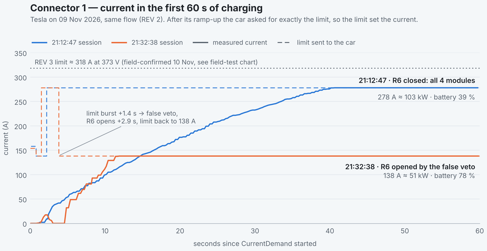
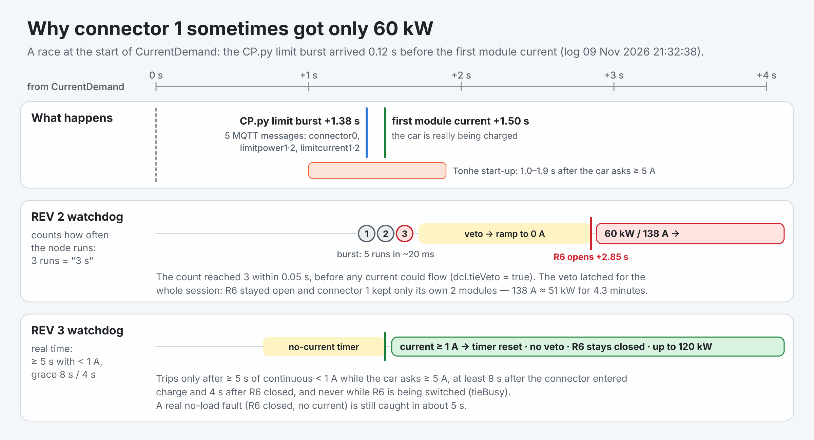

# REV 3 engineering notes

[← Back to the README](../README.md)

**Why connector 1 delivered less power than connector 2, and how REV 3 fixed it.** Log analysis of 09 Nov 2026, the root cause, the changes and the sandbox tests. The result in the cabinet is in the [field results](../README.md#field-results).

`CP.py` in these notes is the OCPP charge-point client on the EdgeBox; it is a separate program and not part of this repository.

## What the logs showed

Both module groups deliver the same power: whenever R6 stayed closed, a single car got **278 A ≈ 103–104 kW** on either connector.
The difference came from the flow **opening R6 by mistake** in some connector-1 sessions, leaving that connector with only its own two modules for the rest of the session.

<picture>
  <source media="(prefers-color-scheme: dark)" srcset="images/connector1-current-dark.png">
  
</picture>

Data: vSECC `power-electronics-com-1.log`, 09 Nov 2026 — table in [`docs/data/connector1_current_20261109.csv`](data/connector1_current_20261109.csv).

**Single-car sessions on 09 Nov 2026**

| Session | Connector | Peak | R6 | CP.py limit burst vs. first module current |
|---|---|---|---|---|
| 20:25:18 ¹ | 1 | 138 A · 50 kW | **vetoed 20:25:21 → open** | burst +1.37 s, current +1.50 s |
| 21:12:47 | 1 | 278 A · 103 kW | closed | current +1.29 s, burst +2.18 s |
| 21:31:30 | 1 | 264 A · 95 kW (30 s session) | closed | current +1.74 s, burst +2.25 s |
| 21:32:38 | 1 | 138 A · 51 kW for 4.3 min | **vetoed 21:32:40 → open 21:32:41** (latched until 21:37:02) | burst +1.38 s, current +1.50 s |
| 21:14:55 · 21:24:00 | 2 | 278 A · 104 kW | closed | current first, burst later (every session) |

¹ REV 1 flow, before the group-2 address fix. Times are seconds after CurrentDemand started.

## Root cause

<picture>
  <source media="(prefers-color-scheme: dark)" srcset="images/rev3-race-dark.png">
  
</picture>

1. **FIX#NOLOAD rev1 tripped falsely.** The "R6 closed but no current" watchdog counted how many times *Calculate Power/Current* ran and tripped at 3.
   That node is woken not only by the 1 s tick but by every `topic/connector0`, `limitpower1/2` and `limitcurrent1/2` message — and CP.py sends those five as a burst when the transaction starts.
   Tonhe modules need 1.0–1.9 s after the car asks ≥ 5 A before current flows, so when the burst arrived first the count reached 3 within 0.05 s → `dcl.tieVeto = true` → function 4 opened R6.
   Connector 2 never hit it only because in its sessions the burst happened to arrive after the first current.
2. **kW → A used the wrong voltage.** `_capV` used `max(measured, target)`; the Tesla sends its maximum, 430.4 V, as target for the whole constant-current phase while the battery sits at ~371–373 V.
   120 kW therefore became 278 A (≈ 103 kW real) and 60 kW became 138 A (≈ 51 kW real) on both connectors.

## What REV 3 changes (5 nodes changed, none added or removed)

| Change | Node | Detail |
|---|---|---|
| **FIX#NOLOAD rev2** | Calculate Power/Current | Trips only after **≥ 5 s of continuous < 1 A** while the car asks ≥ 5 A, at least **8 s** after that connector entered charge and **4 s** after R6 closed, never while R6 is being switched (`dcl.tieBusy`). The reason is kept in `dcl.tieVetoReason`. |
| **FIX#SHARE rev2** | Calculate Power/Current | The "helper group delivers 0 A" watchdog had the same count-based weakness (not seen in these logs); now real-time with the same grace, shares from the modules actually available. |
| **FIX#PCAPV rev1** | Calculate Power/Current | While charging, kW → A uses the **measured bus voltage × 1.01** (1.5 V hysteresis). Cable check, pre-charge or an implausible reading (< 0.6 × target) keep the old formula. `pcap_v_source: 'max'` restores it everywhere. |
| New settings | `set min/max limits + sinexcel_cfg (…, rev3)` | `pcap_v_source`, `noload_trip_ms`, `noload_grace_charge_ms`, `noload_grace_tie_ms` |
| **Trace v3** | ARCH2/session trace | `vsecc/pe/arch2` (stored in `vsecc.log`) adds `maxP`, `lp`, `lc`, `conn0`, `vetoWhy`, `noload`, `shareDegraded` |

**Current limits** (CP.py limit 120 kW per connector, car target 430.4 V) — calculated values; the [field test](../README.md#field-results) measured 284–288 A at 414–418 V (≈ 119 kW) and 160 A at 371 V (≈ 59 kW):

| Situation | REV 2 | REV 3 @ 371 V | REV 3 @ 373 V |
|---|---|---|---|
| One car — R6 closed, 4 modules | 278 A ≈ 103 kW | **320 A ≈ 118.7 kW** | 318 A ≈ 118.6 kW |
| Two cars — R6 open, 2 modules each | 138 A ≈ 51 kW each | **160 A ≈ 59.4 kW each** | 158 A ≈ 58.9 kW each |
| `pcap_v_source: 'max'` | — | 278 A / 138 A (as REV 2) | |

> [!IMPORTANT]
> REV 3 raises the real current from 278 A to about **320 A per connector** at low battery voltage (up to 288 A was measured in the field test at 414 V). Confirm that the CCS cables and connectors are rated for it.
> If not, cap it with `limitcurrent1/2` (CP.py / HMI) or `CURRENT_LIMIT_A` in the config node, or set `pcap_v_source: 'max'`.
> The software ceiling stays at 400 A, as in the original Sinexcel flow. The car (Tesla) reported a maximum of 550 A / 237 kW.

**Sandbox tests** — [`tools/sim_step4.js`](../tools/sim_step4.js) runs the real code of *Calculate Power/Current*, *function 4* and the MQTT store nodes from the REV 2 and REV 3 flows with a controllable clock (all pass):

| Case | REV 2 (deployed) | REV 3 |
|---|---|---|
| Replay of 21:32:38 (burst 120 ms before current) | veto at +1.38 s → R6 open → 138 A ≈ 51 kW | no veto, R6 closed → 318 A ≈ 118.6 kW |
| Burst timing swept −600 … +300 ms around the first current | trips whenever the burst comes first | never trips |
| Real no-load after R6 closes (09 Sep pattern) | veto 2.5 s after R6 settled | veto 5.5 s after R6 settled → R6 reopens, connector 2 resumes on its own group |
| No current at all from the start of CurrentDemand | veto at +1.4 s | veto at +8.4 s |
| `tieBusy` held for 20 s | veto during the switch | ignored; veto 5 s after release if still 0 A |
| Group 2 starts 1 s after group 1, with the burst | `shareDegraded` latched at +1.38 s | no latch (a real 0 A helper latches at 8.4 s) |
