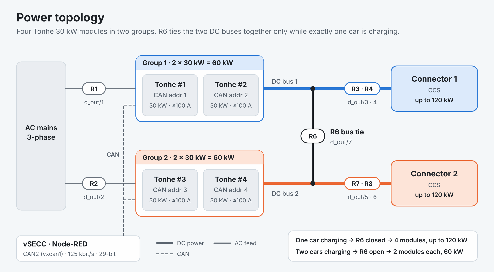
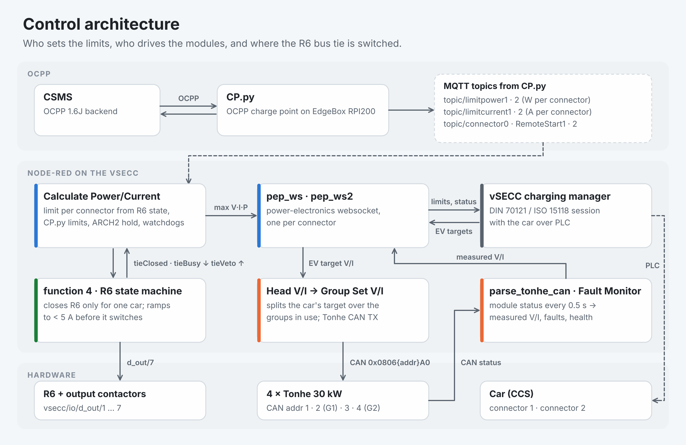

# Technical reference

[← Back to the README](../README.md)

Sharing logic, I/O map, CAN protocol, module setup, configuration and the structure of the flow.

- [Power sharing logic](#power-sharing-logic)
- [Power topology and I/O map](#power-topology-and-io-map)
- [Control architecture](#control-architecture)
- [Tonhe CAN protocol (as used)](#tonhe-can-protocol-as-used)
- [Module setup](#module-setup)
- [Configuration](#configuration)
- [Flow tabs](#flow-tabs)
- [Placeholders in the published flow](#placeholders-in-the-published-flow)

## Power sharing logic

| Connector 1 | Connector 2 | R6 | Connector 1 gets | Connector 2 gets |
|---|---|---|---|---|
| car (B / C / D) | free (A) | **closed** | 4 modules · up to 120 kW | — |
| free (A) | car (B / C / D) | **closed** | — | 4 modules · up to 120 kW |
| car | car | open | 2 modules · 60 kW | 2 modules · 60 kW |
| car | fault (E / F) | open | 2 modules · 60 kW | — |
| free | free | open | both announce 120 kW in advance | |

- **Switching (FIX#TIE, function 4):** the wanted state must be stable for 400 ms; `dcl.tieBusy` makes *Head 1/2 V/I* press the current to 0 A; R6 switches when the total current is below **5 A** (after 6 s it switches anyway and warns); 400 ms settle, then current is released. Function 4 is the only writer of `dcl.tieClosed` / `dcl.tieBusy`.
- **Veto (FIX#NOLOAD):** if R6 is closed and the only car gets no current, `dcl.tieVeto` keeps R6 open until both connectors are free again.
- **Share watchdog (FIX#SHARE):** with R6 closed, if the helper group delivers 0 A the primary group takes the whole target (`dcl.shareDegraded`) until R6 opens.
- **Dynamic share (FIX#DYNSHARE, REV 2):** the target is split over the modules that are actually online and not faulted (`sinexcel_state.groups[g].capable_count`).

## Power topology and I/O map

<picture>
  <source media="(prefers-color-scheme: dark)" srcset="images/power-topology-dark.png">
  
</picture>

| Relay / input | vSECC I/O | Purpose |
|---|---|---|
| R1 · R2 | `d_out/1` · `d_out/2` | AC (Mag) contactors for group 1 · group 2 — feedback on `d_in/7` · `d_in/6` |
| R3 · R4 | `d_out/3` · `d_out/4` | DC+ / DC− contactors, connector 1 |
| R7 · R8 | `d_out/5` · `d_out/6` | DC+ / DC− contactors, connector 2 |
| R6 | `d_out/7` | DC bus tie (group 1 ↔ group 2) |
| Fan | `d_out/11` | cabinet fan |
| Emergency stop | `d_in/8` | cuts both connectors (`ESTOP_IS_GLOBAL = true`, 400 ms debounce) |

## Control architecture

<picture>
  <source media="(prefers-color-scheme: dark)" srcset="images/control-architecture-dark.png">
  
</picture>

Global names were kept from the Sinexcel flow (`sinexcel_cfg`, `sinexcel_state`, `pm.*`, `pep.*`) so the downstream nodes (Head/Group V/I, Calculate, pep_ws, Monitor, External Fault MQTT) did not need rewiring; the Tonhe settings live in `sinexcel_cfg.tonhe`.

## Tonhe CAN protocol (as used)

CAN2 (`vxcan1`), 125 kbit/s, 29-bit extended IDs, little-endian, monitor address `0xA0`.

| Direction | ID | Content |
|---|---|---|
| module → vSECC | `0x1801A0xx` | status every 0.5 s: state (`00` off · `01` on · `11` fault-off), voltage 0.1 V, current 0.01 A, fault word, PFC byte |
| module → vSECC | `0x0802A0xx` | command confirmation |
| module → vSECC | `0x180BA0xx` | AC phase voltages Va / Vb / Vc + ambient temperature |
| module → vSECC | `0x1C91A0xx` | extended status / fault |
| vSECC → module | `0x0806{addr}A0` | **main command**: start `AA` / stop `55`, mode byte, voltage 0.1 V, current 0.01 A |
| vSECC → all | `0x0803FFA0` | broadcast stop |
| vSECC → all | `0x1805FFA0` | timing frame, every 5 s |

`0x1004FFA0` is not used (limited to 750 V). New fault codes in *External Fault MQTT*: `THF` (status fault word) F75/F76 · `THP` (PFC byte) F77/F78 · `THX` (extended fault) F85/F86 · `FAULT_OFF` suffix 11.

## Module setup

| Position | CAN address | Module display |
|---|---|---|
| Connector 1 – module 1 | 1 | `01H` |
| Connector 1 – module 2 | 2 | `02H` |
| Connector 2 – module 1 | **3** | `03H` |
| Connector 2 – module 2 | **4** | `04H` |

All modules: group `G01`, running mode `-A-` (automatic), group mode `-F-` (fixed), protocol `P02` (Tonhe).
The setup document lists 5, 6 for connector 2, but the cabinet uses **3, 4** (found in the logs on 09 Nov 2026). If the addresses change, edit `group_addr` — the Fault Monitor reports `Tonhe address not in config: X` otherwise.

## Configuration

Node `set min/max limits + sinexcel_cfg (Tonhe 2+2x30kW, G2 addr 3,4, rev3)` in tab `phoenix_contact_charx`:

| Setting | Default | Meaning |
|---|---|---|
| `tonhe.group_addr` | `{1:[1,2], 2:[3,4]}` | CAN addresses per group |
| `tonhe.mode_byte` | `0x00` | byte 1 of `0x0806` (spec table: `0x00`, appendix example: `0x01`); `0x00` works on this cabinet |
| `tonhe.stop_below_V` | 60 | a set-point below this sends stop (`0x55`) instead, e.g. during welding detection |
| `tonhe.refresh_ms` · `timing_period_ms` | 500 · 5000 | command refresh (keep-alive) · timing frame |
| `tonhe.online_ms` · `stale_ms` | 3000 · 5000 | module online · stale |
| `MODULE_MAX_POWER` · `_CURRENT` · `_VOLTAGE` | 30 kW · 100 A · 1000 V | per module — check the nameplate |
| `CURRENT_LIMIT_A` | 400 | software ceiling per connector |
| `pcap_v_source` | `'measured'` | REV 3 kW → A voltage; `'max'` = REV 2 formula |
| `noload_trip_ms` | 5000 | REV 3 no-load time before a veto |
| `noload_grace_charge_ms` | 8000 | REV 3 grace after the connector enters charge |
| `noload_grace_tie_ms` | 4000 | REV 3 grace after R6 closed |

## Flow tabs

The flow has 19 tabs, 1437 nodes and 340 function nodes.

| Tab | Role |
|---|---|
| `phoenix_contact_charx` | power-module layer (historic name): Tonhe CAN TX/RX, Head/Group V/I, *Calculate Power/Current*, *function 4* (R6), Fault Monitor, traces |
| `pep_ws(Gun1)` · `pep_ws2(Gun2)` | power-electronics websocket to the vSECC charging manager, one per connector |
| `CCS1_connector_check` · `CCS2_connector_check` | per-connector session logic: authorization (FIX#AUTHBOUNCE, FIX#AUTHWD), RemoteStart / Stop, contactors |
| `Digital_i/o` | AC and DC contactors, R6, fan, emergency stop, Mag feedback |
| `MQTT To HMI` · `HMI_flow` · `RFID Routing` | DWIN HMI screen, start / stop buttons, QR display, RFID (FIX#HMIFLAGS); a disabled copy of `RFID Routing` is kept |
| `External Fault MQTT` | exact fault / status values → raised / cleared events with OCPP 1.6J-ready error codes |
| `imd_simulation` · `BlueJay_IMD_Test` | insulation monitoring (Bluejay GYDCG-UBCS1 IMD × 2, switched by CableCheck) |
| `SoC Cutoff 90%` | hard stop at 90 % state of charge (FIX#SOC) |
| `Monitor` · `Loop Lag Monitor` · `dashboard` | portable monitor snapshot (auto-detects the module brand), event-loop lag alarm, Node-RED dashboard |
| `Flow 2` | session-state test injects and helpers |

## Placeholders in the published flow

The published flow is the REV 3 flow as delivered to the cabinet, with six fields changed by [`tools/sanitize_flow.js`](../tools/sanitize_flow.js). Everything else — all 1437 nodes, their ids and wiring — is identical.

| Where | Public copy |
|---|---|
| `ADMIN_PASSWORD` in *Admin Numpad* (tab `RFID Routing`) and *Admin Numpad (login optional)* (tab `MQTT To HMI`) | `"0000"` — set your own PIN |
| Server of the broker nodes `SukritJa_Broker` and `MON out (dashboard central)` | `broker.example.invalid` — set your own broker |
| Client id of `SukritJa_Broker` | empty (Node-RED generates one) |
| Info text of the comment node in `External Fault MQTT` | broker address replaced |

Local addresses stay as they are: `172.17.0.1` (the vSECC's own MQTT broker) and `192.168.3.11` (the vSECC on the cabinet LAN). MQTT passwords are never part of a Node-RED export, and `flows_cred.json` is excluded by [`.gitignore`](../.gitignore).
